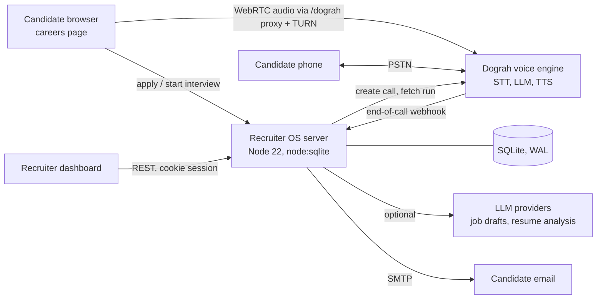
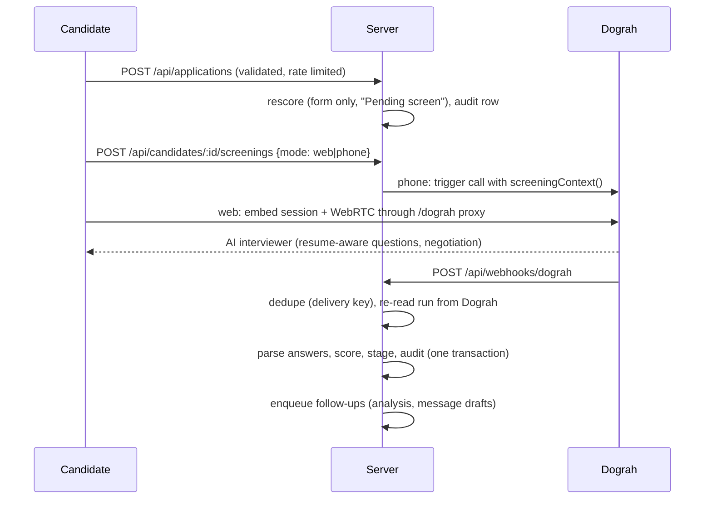

# Architecture

AI Recruiter OS runs AI voice interviews for job applicants, scores them against a 100-point rubric and gives recruiters a ranked pipeline. It is a Next.js web app and a layered Node.js API. Both are served by one process, with an embedded SQLite database. The voice engine ([Dograh](https://github.com/dograh-hq/dograh)) runs separately.

## System view

## Interview lifecycle

A screening is `in_progress`, then `completed` or `incomplete`. A call counts as incomplete when the candidate never spoke or it lasted under 15 seconds. Incomplete calls are kept, with a `failure_reason`, but they are never scored.

## Code layout

| Layer | Path | Responsibility |
|---|---|---|
| Web app | `web/` | Next.js App Router pages: the public careers site, the interview room, booking and the recruiter dashboard. Client components fetch the API with SWR. |
| Composition root | `server.js` | Loads config, opens the database, wires services and routes, runs the request pipeline, handles shutdown |
| Infrastructure | `lib/` | `config` (typed env and validation), `logger` (structured logs with redaction), `http` (router, errors, bounded body reader), `validate` (schemas), `resilience` (retry, circuit breaker), `metrics` (Prometheus), `rate-limit` (token bucket), `session` (signed expiring cookies), `db` (migrations, transactions) |
| Schema | `db/migrations.js` | Versioned migrations, each applied once inside a transaction |
| Domain services | `services/` | `screening` (the agent contract, pure functions), `interviews` (lifecycle and webhook), `candidates` (reads, scoring, audit), `dograh` (voice engine client), `relay` (TURN credentials) |
| HTTP routes | `routes/core.js` | Thin handlers: validate, call a service, shape the response |
| Rubric | `scoring.js` | Answer parsing, the 100-point score, explanations, resume probes |
| Recruiting suite | `suite.js` | Roles, CSV import, call queue, interviews, offers, automation worker, auth |
| Voice agent | `dograh/` | Workflow definitions and prompts. `screeningContext()` is their contract |

Dependencies point one way: routes, then services, then lib. Services take their collaborators as arguments (`createInterviewService({ db, candidates, dograh, ... })`), so tests can replace any of them.

## Why one process hosts both the pages and the API

The Next.js app runs inside `server.js` as a custom server instead of as Route Handlers. Three things need a long-lived process that serverless handlers can't give:

1. **WebSocket proxy.** Browser interviews reach Dograh's signaling WebSocket through this server (`/dograh/...`), so a candidate only ever talks to one origin.
2. **Background worker.** The task queue runs analyses, call queues and reminders.
3. **Single-writer SQLite.**

Next.js handles every non-API path; the API keeps its own router, validation and error model. `RECRUIT_UI=off` runs the API alone, which the end-to-end tests use.

## Request pipeline

Every request gets an `X-Request-Id`, which is also on every log line. The pipeline runs these steps in order:

1. Tunnel guard.
2. Dograh proxy (public embed endpoints only).
3. Health, readiness and metrics.
4. Suite routes (these include the authentication gate).
5. Core router.
6. The Next.js app (security headers are set before Next.js starts the response).

Errors are typed (`HttpError`). In production, an unexpected error returns a generic message, and the detail goes to the log.

## Reliability

- **Dograh calls** run through a circuit breaker: 5 transient failures open it for 30 seconds.
  - Reads are retried with exponential backoff and jitter.
  - Call triggers are never retried, because a retry after a timeout could ring a candidate twice.
- **Webhooks are idempotent.** A redelivered result is recognised by its delivery key and answered without scoring or notifying again.
- **Writes that belong together** (screening result, score, stage, audit row, events) commit in one transaction.
- **Background work** runs on a database task queue with attempts, retry delays and calling-hours windows.
- **Graceful shutdown** on SIGTERM:
  - the server stops taking requests;
  - in-flight requests get 10 seconds to finish;
  - the database closes cleanly.
- **Probes**: `/api/health` is liveness and `/api/ready` is readiness (database, Dograh, breaker state). `/metrics` serves Prometheus counters and histograms.

## AI quality and fairness

- **The agent contract.** `services/screening.js` builds every variable the interviewer prompt uses. A unit test fails the build if the prompt references a variable the server never sends.
- **Deterministic, explainable scoring.** Each of the six rubric parts carries a reason. Knockouts (salary over 30% above budget, can't work from the location, far below the experience minimum) force a Reject and state why.
- **Audit trail.** Every score is stored in `score_audit` with the rubric version, a hash of its exact inputs and what triggered it, so any automated decision can be reproduced.
- **Bias guards.**
  - Sentences about age, marital status, family, religion or health are removed before answer-quality scoring.
  - Fairness tests check that swapping the candidate's name never changes the score.
  - Some auto-rejects are sampled for human review.
  - Recruiters mark each AI screen as helpful or not.
- **Offline evals.** `npm run eval` runs labelled interviews through parsing and scoring. It reports extraction accuracy, verdict accuracy with a confusion matrix, flag recall and fairness. CI fails below the gates.

## Data and security

See [SECURITY.md](../SECURITY.md). In short:

- secrets are encrypted at rest and never returned by the API;
- sessions are signed and expire;
- logins and public forms are rate limited;
- phone calls only reach allowlisted numbers until production mode is switched on;
- personal data is removed from prompts before they go to an LLM.

## Scaling notes

Measured on a 4-core laptop, one process runs 3 to 5 browser interviews at once. That limit comes from Dograh's voice pipeline, not this server. To grow:

1. Run Dograh with more workers or on its own host.
2. Move the rate limiter and the trace buffer to Redis.
3. Move SQLite to Postgres. The SQL is plain and goes through one access layer.
